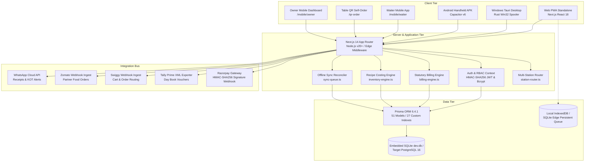

# RestaurantOS — Technical Architecture & Project Overview

**Document:** `AUDIT_PACKAGE/PROJECT_OVERVIEW.md`  
**Purpose:** External AI & Human Developer Code Review, Security Audit, and Performance Analysis  
**System Version:** `1.4.0-PROD`  
**Auditor Target:** Full-Stack Architecture, Code Soundness, and Data Isolation  

---

## 1. System High-Level Architecture

RestaurantOS is an enterprise multi-tenant Food & Beverage (F&B) operating system designed specifically for the Indian restaurant industry. It combines high-speed touch Point of Sale (POS), Kitchen Display System (KDS), statutory Indian GST compliance (CGST 2.5% + SGST 2.5%), transactional recipe Bill of Materials (BOM) inventory deductions, multi-branch operations, offline-first local queue reconciliation, customer loyalty CRM, workforce management, and platform SaaS subscription billing into a single unified full-stack codebase.



---

## 2. Technology Stack & Runtime Specifications

| Layer | Technology | Version | Purpose |
| :--- | :--- | :---: | :--- |
| **Framework** | Next.js (App Router) | `14.2.23` | Server-side rendering, dynamic API routes, static generation, middleware. |
| **Frontend UI** | React | `18.3.1` | Touch-first responsive component hierarchy. |
| **Styling** | Tailwind CSS | `3.4.16` | Utility-first responsive styling with custom design tokens. |
| **Icons & Visuals** | Lucide React | `0.468.0` | High-contrast vector interface icons. |
| **State Management**| Zustand | `5.0.2` | High-performance client-side stores (cart, restaurant context). |
| **Data Fetching** | TanStack React Query | `5.62.0` | Client-side caching, background refetching, mutation states. |
| **ORM / Data Access**| Prisma Client | `6.4.1` | Strongly typed database queries, migrations, atomic transactions. |
| **Database** | SQLite (dev.db) / PostgreSQL | `6.4.1` / `16` | Embedded edge storage with clean PostgreSQL production compatibility. |
| **Authentication** | Bcrypt.js & JSONWebToken | `3.0.3` / `9.0.3` | Password hashing, HMAC-SHA256 session tokens, HTTP-only cookies. |
| **Document Engine** | PDFKit | `0.20.2` | Publication-grade server-side PDF generation for reports & manuals. |
| **Desktop Wrapper** | Tauri (Rust) | `1.5` | Lightweight native Windows wrapper with Win32 print spooler. |
| **Mobile Wrapper** | Capacitor | `6.x` | Android wrapper with camera, Bluetooth, and background wake lock. |
| **Runtime** | Node.js | `v20.x+` | JavaScript/TypeScript server execution runtime. |
| **TypeScript** | TypeScript Compiler | `5.7.2` | 100% strict type safety across all client and server files. |

---

## 3. Directory Layout & Codebase Structure

The application is structured as a clean Next.js monorepo layout:

```
restaurantos/
├── apps/
│   └── web/                                  # Primary Next.js App Router Web Application
│       ├── android/                          # Capacitor Android native project & manifest
│       ├── prisma/                           # Prisma schema (schema.prisma), seeders & dev.db
│       ├── public/                           # Static assets, PWA manifest, service worker (sw.js)
│       ├── scripts/                          # Automated verification suites & test runners (56 tests)
│       ├── src/
│       │   ├── app/                          # Next.js App Router pages & API routes (45 pages, 62 APIs)
│       │   ├── components/                   # Reusable UI components, modals, and layouts
│       │   ├── hooks/                        # Custom React hooks (useSyncQueue, useBarcodeScanner)
│       │   ├── lib/                          # Core business logic, services & hardware drivers
│       │   │   ├── hardware/                 # ESC/POS printer, customer display, barcode parser
│       │   │   ├── integrations/             # WhatsApp, Zomato, Swiggy, Tally, Razorpay drivers
│       │   │   ├── offline/                  # Persistent queue, SQLite/IndexedDB adapters
│       │   │   └── server/                   # RBAC, billing, inventory BOM, loyalty, analytics
│       │   └── stores/                       # Zustand client state stores (cart, restaurant context)
│       ├── src-tauri/                        # Tauri native desktop Rust harness & Win32 commands
│       ├── capacitor.config.json             # Capacitor mobile configuration
│       ├── Dockerfile                        # Production container build manifest
│       ├── package.json                      # Dependency manifest
│       └── tsconfig.json                     # TypeScript compiler configuration
├── backups/                                  # Automated SQLite database snapshot archives
├── docs/                                     # System documentation, installation & manuals
├── documentation/                            # QA reports, bug fix ledgers, and onboarding manuals
├── release/                                  # Release deliverables (PDF manuals, setup templates)
├── scripts/                                  # Database backup/restore scripts (.bat and .sh)
├── docker-compose.yml                        # Docker multi-container service definition
└── .env.example                              # Sanitized environment configuration template
```

---

## 4. Authentication, Authorization & Session Security

- **Authentication Protocol:** Bcrypt password hashing (`bcrypt.hash(password, 10)`). Quick 4-digit POS PINs for cashier terminal switching.
- **Session Tokens:** Cryptographically signed HMAC-SHA256 JWT tokens containing `userId`, `organizationId`, `organizationSlug`, `role`, and `assignedBranchId`.
- **Cookie Security:** Tokens are delivered in HTTP-only, secure, same-site `lax` cookies (`restaurantos_session`), preventing XSS token theft.
- **Granular RBAC:** 8 discrete roles (`TENANT_OWNER`, `ADMINISTRATOR`, `MANAGER`, `CASHIER`, `WAITER`, `KITCHEN_STAFF`, `INVENTORY_MANAGER`, `ACCOUNTANT`).
- **Anti-Escalation Barrier:** Middleware and API route handlers strictly validate tenant ownership against database records. Frontend-supplied tenant IDs in request bodies or query parameters are never trusted.

---

## 5. Deployment Options

1. **Docker Containerized Deployment:** Production multi-container deployment via `docker-compose.yml` (Next.js web container + PostgreSQL + Redis).
2. **On-Premise In-Store Server:** Node.js production service running on local Windows or Linux server on port 3000.
3. **PWA Standalone Kiosk:** Installed on cashier touch PCs and tablets directly from Google Chrome / Edge.
4. **Desktop Tauri Binary:** Native `.msi` Windows application with direct Win32 print spooler communication.
5. **Mobile Handheld APK:** Capacitor Android release for waiters and wireless thermal belt printers.
